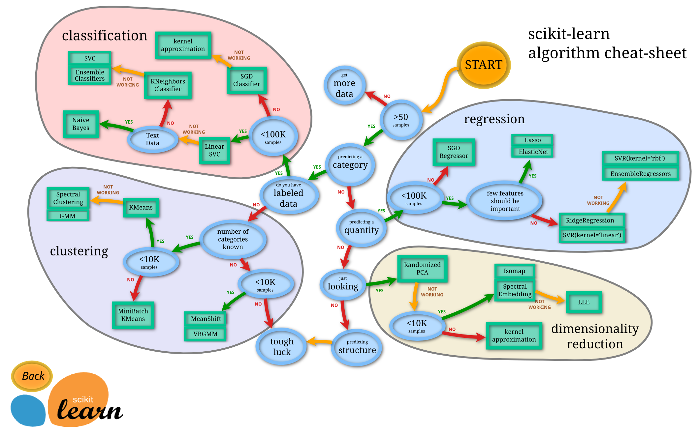

# ML / General / ML Landscape

Machine Learning: Programming computers to learn from data.

Examples:
- Analyzing images of products on a production line to automatically classify them;
  - image classification, convolutional neural networks (CNN);
- Detecting tumors in brain scans;
  - semantic segmentation, CNNs;
- Automatically classifying news articles;
  - natural language processing (NLP), specifically, text classification, recurrent neural networks (RNN), CNNs or Transfomers;
- Automatically flagging offensive comments on discussion forums;
  - NLP, text classification;
- Summarize long docs automatically;
  - NLP, text summarization;
- Chatbot;
  - NLP components, including natural language understanding (NLU) and question-answering modules;
- forecast revenue
  - regression (linear, polynomial, regression SVM, regression random forest, artificial neural network)
  - if taking into account sequences of past performance metrics: RNNs, CNNs, Transformers
- voice command app;
  - speech recognition, RNNs, CNNs, Transformers;
- credit card fraud;
  - anomaly detection;
- segment clients based on purchases;
  - clustering;
- represent a complex, high-dimensional dataset in an insightful diagram;
  - data visualization using dimensionality reduction;
- recommend a product a client may be interested in, based on past purchases;
  - recommender system (collaborative, content, hybrid), ANN
- building intelligent bot;
  - reinforcement learning;

## Types of Learning

### Supervised Learning**: Output labels are available;
- k-Nearest Neighbors
- Linear Regression
- Logistic Regression
- Support Vector Machines (SVMs)
- Decision Trees and Random Forests
- Neural Networks (the supervised kind)

### **Unsupervised Learning**: Output labels are not available;
- Clustering
  - K-Means
  - DBScan
  - Hierarhical Cluster Analysis
- Anomaly detection and novelty detection
  - One-class SVM
  - Isolation forest
- Visualization and dimensionality reduction
  - Principal Component Analysis (PCA)
  - Kernel PCA
  - Locally Linear Embedding (LLE)
  - t-Distributed Stochastic Neighbour Embedding (t-SNE)
- Association rule learning
  - Apriori
  - Eclat

### **Dimensionality Reduction**
- merge several correlated features into one.
- algos will run faster,
- take up less space,
- and _sometimes_, even be more accurate.

### **Semisupervised Learning**: a few labelled instances, the rest not labelled;
- Ex: Google Photos
- Deep Belief Networks (DBNs) based on unsupervised components (Restricted Bolzmann Machines (RBMs) stacked on top of each other, trained unsupervized, then fine-tuned supervised);

### **Reinforcement Learning**:
- agent observes environment, select/perform actions and get _rewards_ in return (or _penalties_);
- learns the _policy_ (ie. strategy) by itself;

### **Batch** vs **Online** Learning:
- Batch: not incremental; all learning is at once; offline learning;

